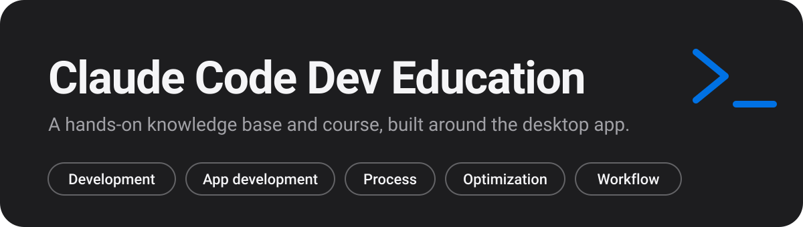

<p align="center"></p>

# Claude Code Dev Education

An unofficial, hands-on knowledge base and course for Claude Code, built around the Claude desktop app's Code tab. It takes you from your first session to advanced workflows, with development, app building, process, optimization and workflow automation at the center. Terminal tips appear only where the terminal is faster or required.

> Independent and unofficial. This project is not affiliated with or endorsed by Anthropic.

**Read it on the web:** https://gkistlergit.github.io/claude-code-dev-education/

## What You Get

| Part | What it is | Where |
|---|---|---|
| Course | Four levels, 14 modules, each with objectives, readings, an exercise, a success check and checkpoint questions | [`learn/`](learn/start-here.md) |
| Knowledge base | 79 articles in ten areas, each with steps, a worked example, pitfalls and a checkpoint | [`kb/`](kb/outline.json) |
| Capstones | One project per level, plus an advanced pair, and a rubric that defines "Advanced" | [`capstones/`](capstones/capstone-0-first-session.md), [`assessment/`](assessment/rubric.md) |
| Sample project | Trail Notes, a small framework-free notes app with a seeded bug, checks and three solutions | [`exercises/`](exercises/trail-notes-starter/README.md) |
| Templates and prompts | Ten files to copy and twelve tested prompts | [`templates/`](templates/claude-md.md), [`prompts/`](prompts/explore-a-repo.md) |
| Cheatsheets and glossary | Shortcuts, commands, terminal tips and 48 terms | [`cheatsheets/`](cheatsheets/desktop-shortcuts.md), [`kb/glossary.md`](kb/glossary.md) |

## The Course

| Level | Name | Modules | Capstone |
|---|---|---|---|
| 0 | Orientation | 1 | [A first session](capstones/capstone-0-first-session.md) |
| 1 | Beginner | 3 | [Fix and review a bug](capstones/capstone-1-fix-and-review.md) |
| 2 | Intermediate | 5 | [Ship a feature](capstones/capstone-2-ship-a-feature.md) |
| 3 | Advanced | 5 | [An offline-first app](capstones/capstone-3a-offline-first-app.md) and [optimize a workflow](capstones/capstone-3b-optimize-a-workflow.md) |

Start with [Start Here](learn/start-here.md). Three tracks cut across the levels: [app development](learn/track-app-development.md), [process](learn/track-process.md) and [optimization](learn/track-optimization.md).

## The Knowledge Base

| Area | Articles | What it covers |
|---|---|---|
| Desktop App | 12 | The Code tab, feature by feature |
| Development | 9 | Everyday coding with Claude |
| App Development | 11 | Building a small app from idea to production |
| Process | 8 | From idea to deploy, with gates |
| Optimization | 8 | Context, models, speed and measurement |
| Workflow | 11 | Rules, memory, skills, hooks and automation |
| Recipes | 5 | Step-by-step playbooks |
| Decision Guides | 5 | Pick the right option fast |
| Troubleshooting | 5 | Symptoms and fixes |
| Terminal Tips | 5 | The commands worth knowing |

## How It Was Built

- **Grounded in real use.** The examples come from one developer's daily work in the desktop app. [Usage Audit](docs/usage-audit.md) and [Patterns from Practice](docs/patterns-from-practice.md) hold the anonymized findings.
- **Checked against the docs.** Claims about Claude Code and the app were checked against the official docs, and [the verification log](docs/verification-log.md) records what was found, including features that are beta or research preview and things the app shows that the docs do not describe. Behavior in the app was not tested unless a page says so.
- **Free to follow.** Nothing needs a paid service beyond the Claude subscription you already have. Exercises run locally with Node.js and a free GitHub account.
- **Checked by scripts.** `npm test` checks every page's structure, links, length and wording rules, scans for private names, and checks color contrast in both themes.

## Run It Locally

You need Node.js 20 or later.

```sh
npm ci
npm run build
open site/index.html
```

`npm test` runs the content and contrast checks. The Trail Notes checks run on their own: `cd exercises/trail-notes-starter && node checks/run.mjs`. The starter is meant to fail one check.

## Repository Layout

```text
kb/            knowledge base articles, outline.json and the glossary
learn/         course levels, modules and tracks
capstones/     one project per level
assessment/    the rubric
exercises/     Trail Notes starter, solutions and the optimization worksheet
templates/     files to copy
prompts/       prompts to paste
cheatsheets/   shortcuts, commands and terminal tips
docs/          usage audit, patterns, verification log, design system, authoring guide
site-src/      the site's tokens, styles and script
tools/         the site builder and the checks
```

## Corrections

Found something wrong or out of date? Open an issue with the page and what you saw. Claude Code changes quickly, so pages carry the date they were checked.

## License

Code is MIT licensed ([`LICENSE`](LICENSE)). Written content is licensed under [CC BY 4.0](LICENSE-CONTENT.md).
